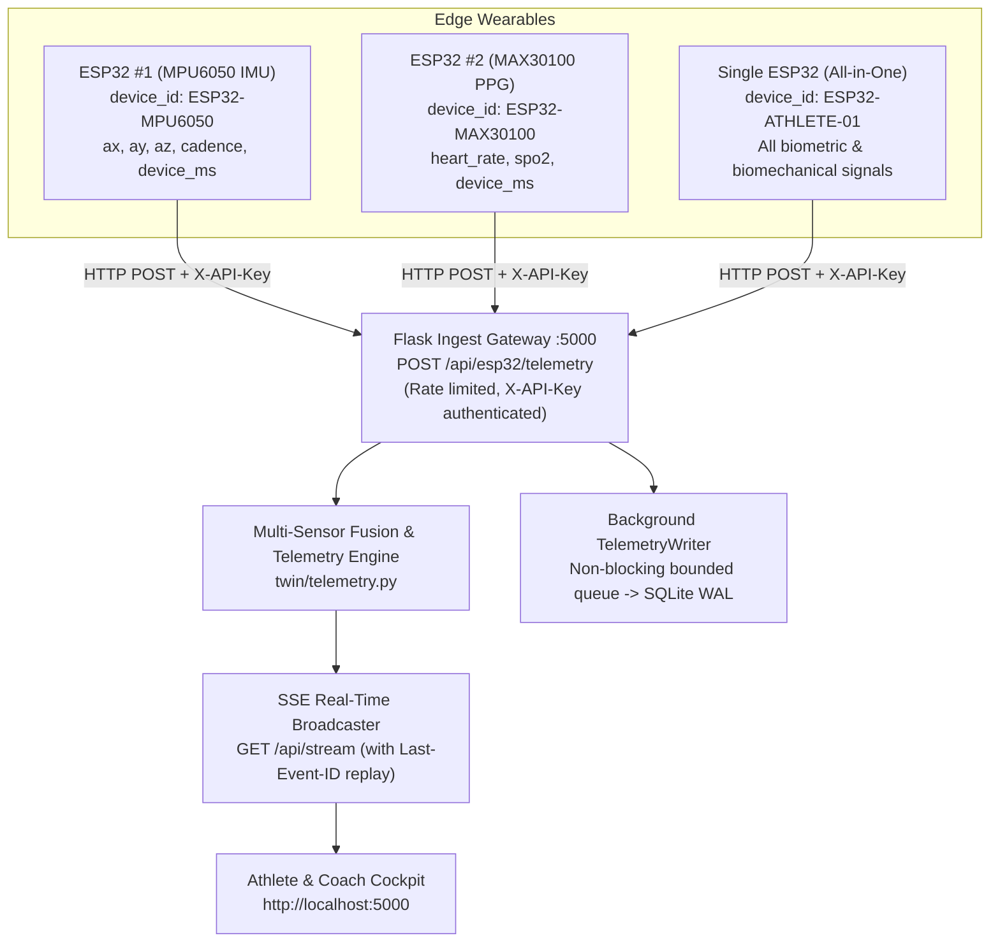

# ESP32 Athlete Tracker: Wiring, Hardware & Setup Guide

This guide explains how to connect sensors to your ESP32 microcontrollers, resolve common hardware breakout issues, configure API keys, and flash the firmware sketches to stream real-time biometric and biomechanical data to the **Digital Twin Athlete** platform.

---

## 📐 Architecture Options

The system supports two edge hardware configurations:

1. **Dual ESP32 Configuration (Modular Wearable)**:
   - **ESP32 #1 (`ESP32-MPU6050`)**: Dedicated MPU6050 6-axis IMU (gait, cadence, impact $g$).
   - **ESP32 #2 (`ESP32-MAX30100`)**: Dedicated MAX30100 optical pulse oximeter (heart rate, $\text{SpO}_2$, cardiovascular zones).
   - Sensor fusion merges both feeds into a single athlete digital twin model in real time.

2. **Single ESP32 Configuration (All-in-One Wearable)**:
   - **ESP32 Tracker (`ESP32-ATHLETE-01`)**: Both MAX30100 and MPU6050 wired to the same I2C bus (`GPIO 21` SDA, `GPIO 22` SCL).
   - Driven by `firmware/esp32_athlete_tracker/esp32_athlete_tracker.ino`.



---

## ⚠️ CRITICAL HARDWARE NOTE: MAX30100 Breakout Voltage & Pull-Up Issue

> [!CAUTION]
> **The 1.8V Pull-Up Resistor Defect on Common MAX30100 Breakouts (RC522 / GY-MAX30100)**:
> 
> Many generic green/purple MAX30100 breakout boards sold online have a known PCB manufacturing flaw: the on-board I2C pull-up resistor array (typically marked `472` for 4.7 kΩ) has its common rail wired to the output of the on-board **1.8V voltage regulator** instead of the 3.3V rail.
> 
> - **The Problem**: The ESP32 I2C pins require logic HIGH voltages of at least $0.75 \times V_{DD} \approx 2.47\text{ V}$. Because the lines are pulled up to only 1.8V, the ESP32 cannot reliably detect I2C ACK pulses. Symptoms include:
>   - I2C scanner reports `NOT DETECTED (0x57)`.
>   - Firmware hangs at `Wire.endTransmission()`.
>   - Sporadic sensor disconnections.
> 
> - **How to Resolve**:
>   1. **Power Supply**: Always connect `VIN` to the ESP32 **3.3V** pin (do NOT connect to 5V).
>   2. **Hardware Fix (Recommended)**: Desolder or gently scrape away the 3-resistor array connected to the 1.8V trace, and connect external 4.7 kΩ pull-up resistors from ESP32 `GPIO 21 (SDA)` and `GPIO 22 (SCL)` to the ESP32 **3.3V** rail.
>   3. **Alternate Fix**: If your breakout has an unpopulated 3-pin solder bridge or trace near the regulator, bridge the pull-up array to the 3.3V input pad.
>   4. **Fallback Mode**: If you do not have a soldering iron handy, both firmware sketches include an automated realistic physiological signal generator that activates whenever `checkI2CDevice(0x57)` returns `false`.

---

## 1. Hardware Pinouts & Wiring Tables

### Configuration A: Dual ESP32 Setup

#### ESP32 #1 — MPU6050 Motion Sensor
- **Firmware Sketch:** `firmware/esp32_mpu6050/esp32_mpu6050.ino`
- **Default Device ID:** `ESP32-MPU6050`
- **I2C Address:** `0x68`

| ESP32 Pin | MPU6050 Pin | Description |
| :--- | :--- | :--- |
| **3.3V** | VCC | 3.3V Logic & Power |
| **GND** | GND | Common Ground |
| **GPIO 21** | SDA | I2C Data |
| **GPIO 22** | SCL | I2C Clock |

#### ESP32 #2 — MAX30100 Pulse Oximeter & Heart Rate
- **Firmware Sketch:** `firmware/esp32_max30100/esp32_max30100.ino`
- **Default Device ID:** `ESP32-MAX30100`
- **I2C Address:** `0x57`

| ESP32 Pin | MAX30100 Pin | Description |
| :--- | :--- | :--- |
| **3.3V** | VIN / VCC | 3.3V Power (Do NOT use 5V) |
| **GND** | GND | Common Ground |
| **GPIO 21** | SDA | I2C Data Line (Ensure 3.3V pull-up) |
| **GPIO 22** | SCL | I2C Clock Line (Ensure 3.3V pull-up) |

---

### Configuration B: Single All-in-One ESP32 Setup
- **Firmware Sketch:** `firmware/esp32_athlete_tracker/esp32_athlete_tracker.ino`
- **Default Device ID:** `ESP32-ATHLETE-01`
- **Bus:** Both sensors share the ESP32 hardware I2C bus (`Wire` on GPIO 21 / 22) because their addresses are distinct (`0x57` for MAX30100, `0x68` for MPU6050).

| ESP32 Pin | MAX30100 Pin | MPU6050 Pin | Description |
| :--- | :--- | :--- | :--- |
| **3.3V** | VIN | VCC | 3.3V Power Rail |
| **GND** | GND | GND | Common Ground Rail |
| **GPIO 21** | SDA | SDA | Shared I2C Data Line |
| **GPIO 22** | SCL | SCL | Shared I2C Clock Line |

---

## 2. API Key Configuration & Firmware Setup

To authenticate with the server and prevent unauthorized telemetry injection, configure `config.h`:

1. Copy the example configuration template:
   ```bash
   cp firmware/config.example.h firmware/config.h
   # Or copy directly inside each sketch directory if needed:
   cp firmware/config.example.h firmware/esp32_athlete_tracker/config.h
   cp firmware/config.example.h firmware/esp32_max30100/config.h
   cp firmware/config.example.h firmware/esp32_mpu6050/config.h
   ```
2. Edit `config.h` with your local Wi-Fi and API keys:
   ```cpp
   #pragma once

   #define WIFI_SSID       "YourWiFiNetwork"
   #define WIFI_PASSWORD   "YourWiFiPassword"
   #define SERVER_URL      "http://192.168.1.100:5000/api/esp32/telemetry"

   #define DEVICE_ID       "ESP32-ATHLETE-01"
   #define TWIN_API_KEY    "secret-key-1"
   ```
   *(Note: `config.h` is gitignored so your personal credentials are never committed to version control.)*

3. Ensure the server has matching API keys defined in the `TWIN_API_KEYS` environment variable:
   ```bash
   export TWIN_API_KEYS="ESP32-ATHLETE-01:secret-key-1,ESP32-MAX30100:secret-key-2,ESP32-MPU6050:secret-key-3"
   ```

---

## 3. Flashing with Arduino IDE

1. Open Arduino IDE (v2.0+ recommended).
2. Install the **ESP32 board package** via Boards Manager (`esp32 by Espressif Systems`).
3. Select board: **ESP32 Dev Module** (or your specific dev board model).
4. Set Upload Speed: `921600` (or `115200` if upload fails).
5. Open the target sketch:
   - All-in-one: `firmware/esp32_athlete_tracker/esp32_athlete_tracker.ino`
   - Dedicated PPG: `firmware/esp32_max30100/esp32_max30100.ino`
   - Dedicated IMU: `firmware/esp32_mpu6050/esp32_mpu6050.ino`
6. Click **Upload**.
7. Open Serial Monitor at **115200 baud** to verify I2C probe status, Wi-Fi association, and transmission logs.

---

## 4. USB Serial Bridge Fallback (No Wi-Fi)

If Wi-Fi is restricted in your training facility or field location, you can stream sensor data directly over USB serial using the included bridge script:

```bash
python scripts/esp32_serial_bridge.py --port COM3 --baud 115200 --url http://127.0.0.1:5000/api/esp32/telemetry --api-key secret-key-1
```

The bridge reads JSON telemetry lines from the serial port, attaches the `X-API-Key` header, and POSTs them to the local server gateway.
